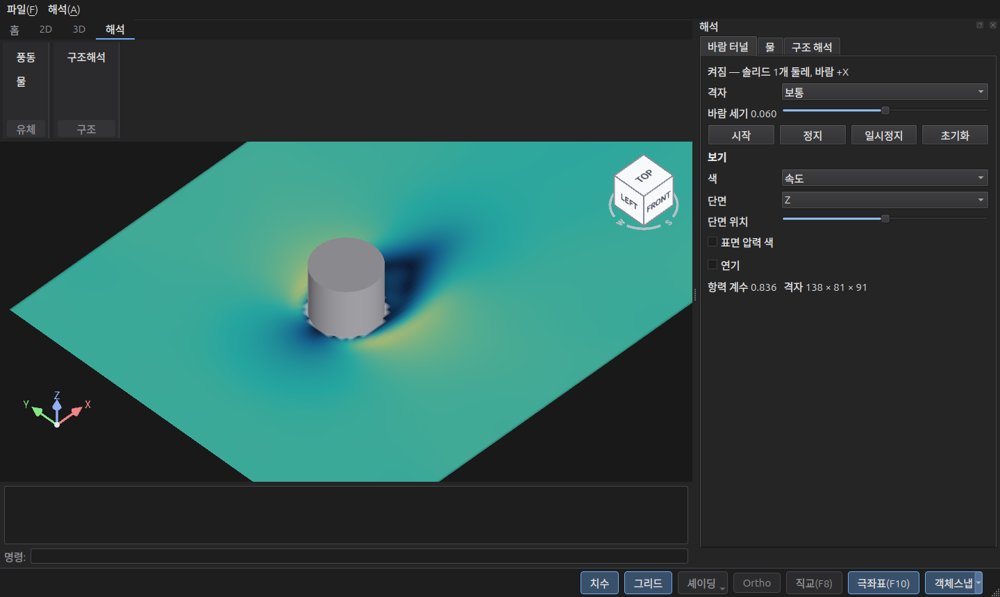
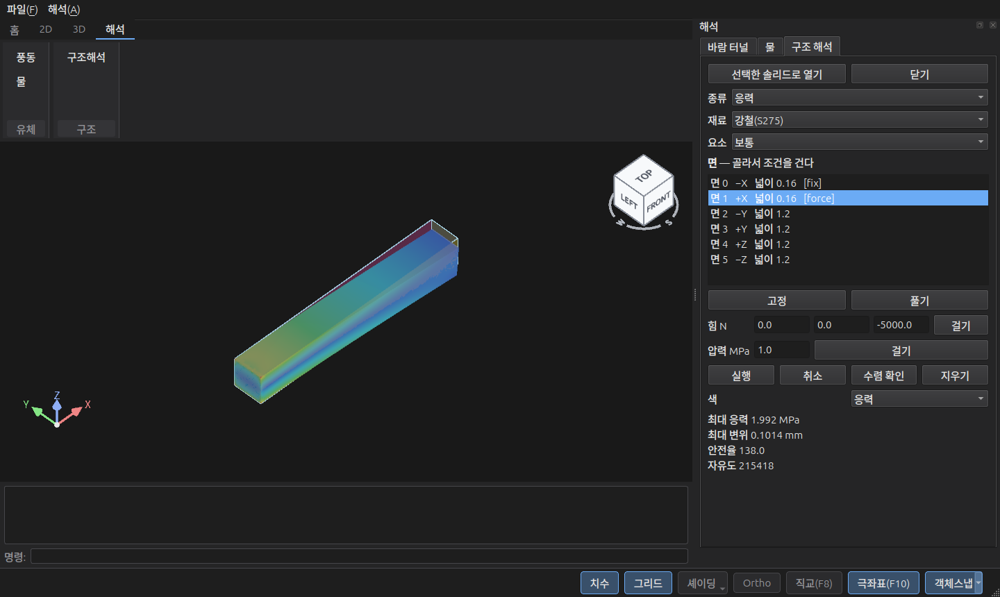

# python — PySide6 호스트 샘플

LotCAD 엔진을 파이썬(PySide6) 창 안에 띄운다. MFC 샘플과 같은 구성 —
리본(홈 / 2D / 3D / 해석) · 3D 뷰 · 오토캐드식 명령행 · 상태바 토글(치수·그리드·스타일·투영·직교·극좌표·객체스냅) ·
해석 패널(바람 터널 · 물 · 구조 해석).
Windows · macOS(Apple Silicon) · Ubuntu 에서 같은 코드로 돈다.

## 실행

| OS | 준비 (처음 한 번) | 실행 |
|----|------------------|------|
| Windows | `setup.bat` | `run.bat` |
| macOS · Ubuntu | `./setup.sh` | `./run.sh` |

`setup` 은 이 폴더에 가상환경(`.venv`)을 만들고 PySide6 를 설치한다. 파이썬 3.9 이상이 필요하다.

- **Ubuntu** — 시스템 패키지가 필요하다. `setup.sh` 가 없는 것만 모아 설치할지 묻고 `sudo apt-get` 으로 깐다
  (`./setup.sh -y` 는 묻지 않고, CI 처럼 터미널이 아니면 명령만 알려 주고 멈춘다). 직접 깔려면:
  `sudo apt install python3-venv libvulkan1 mesa-vulkan-drivers libgtk-3-0 libxcb-cursor0`.
  Wayland 세션에서도 Qt 를 X11(XWayland)로 띄운다 — 엔진의 리눅스 임베드가 X11 창만 받기 때문.
- **macOS** — 엔진 라이브러리는 Apple Silicon(arm64) 전용이라 파이썬도 arm64 여야 한다. Vulkan SDK 는 필요 없다(MoltenVK 내장).

## 파이썬에서 엔진 부르기 — `sdk/python/lotcad`

엔진 C API(`sdk/include/LotCAD_API.h`)의 **함수 전부**를 파이썬으로 옮긴 바인딩이다. 헤더에서 자동 생성되며
(엔진의 `tools/gen_python_binding.py`), 파이썬 표준 모듈 `ctypes` 만 쓴다 — 바인딩 자체는 설치할 것이 없다.

```python
import sys; sys.path.insert(0, "<샘플 레포>/sdk/python")
import lotcad

if lotcad.CAD_SetRuntimeAssetPath(lotcad.SDK_DIR) != lotcad.CAD_OK:   # models·fonts·textures 위치 (0 = CAD_OK)
    print(lotcad.CAD_GetLastError())
lotcad.CAD_CreateEngine()                         # 창을 붙이지 않으면 엔진이 자기 창을 연다 (루프 함수라 bool)
st, box = lotcad.CAD_CreateBox(lotcad.CAD_GeVec3(0, 0, 0.5), lotcad.CAD_GeVec3(1, 1, 1))   # 결과 코드 + 새 id
st, p = lotcad.CAD_GetPosition(box)               # 출력 인자는 (결과 코드, 값) 으로
print(lotcad.CAD_GetObjectJson(box))              # 문자열 버퍼는 str 로
lotcad.CAD_SetOnPrompt(lambda text: print(text))  # 콜백은 파이썬 함수 그대로 — 바인딩이 붙잡아 둔다

def on_event(kind, id, user):                     # 객체·선택·문서 알림은 이것 하나(kind 로 가른다)
    if kind == lotcad.CAD_EVENT_SELECTION_CHANGED: print("선택 바뀜")
    elif kind == lotcad.CAD_EVENT_DOCUMENT_DIRTY:  print("문서 변경", bool(id))
st, handle = lotcad.CAD_AddEventListener(
    lotcad.CAD_EVENT_SELECTION_CHANGED | lotcad.CAD_EVENT_DOCUMENT_DIRTY, on_event, None, 0)   # 0 = 호스트
# 끊을 때: lotcad.CAD_RemoveEventListener(handle)
while not lotcad.CAD_ShouldClose() and lotcad.CAD_Tick():
    pass
lotcad.CAD_DestroyEngine()
```

- 함수 이름·의미는 헤더와 같다. `help(lotcad.CAD_CreateBox)` 에 C 선언과 헤더 주석이 있다.
- 문자열은 `str` (UTF-8 로 자동 변환), 배열 입력은 목록·튜플.
- 배열을 **돌려받는** 함수는 버퍼를 만들어 넘긴다 — 개수 단위가 함수마다 달라(점 n개 = float 2n칸 등) 자동으로 정하지 않는다:
  `ids = lotcad.buffer(ctypes.c_uint32, n); lotcad.CAD_GetObjectIds(ids, n)`
- 헤더와 똑같은 원시 함수(포인터를 직접)는 `lotcad.native.CAD_xxx`.
- 라이브러리는 `sdk/` 에서 OS 에 맞는 것(`LotCADCore.dll` · `libLotCADCore.dylib` · `libLotCADCore.so`)을 찾는다.
  다른 곳의 것을 쓰려면 환경 변수 `LOTCAD_LIBRARY` 에 파일 경로.
- 엔진 함수는 엔진을 만든 스레드에서만 부른다. 콜백도 `CAD_Tick` 안, 같은 스레드에서 온다.

## 파일

| 파일 | 내용 |
|------|------|
| `main.py` | 시작 — 바인딩 경로·Qt 플랫폼(리눅스 X11)·테마 |
| `cad_view.py` | 3D 뷰 — 엔진이 그리는 네이티브 창(`QWindow`)을 붙이고 마우스를 넘긴다 |
| `main_window.py` | 리본 버튼에 엔진 명령 달기 · 파일·해석 메뉴 · 키 처리 · 차집합 |
| `analysis.py` | 해석 패널 — `CAD_WindTunnel` · `CAD_Water` · `CAD_StructuralAnalysis` (2회 호출 규약을 직접 지킨다) |
| `command_line.py` | 명령행 — 기록·안내문(`CAD_SetOnPrompt`)·↑↓ 기록·빈 Enter 반복·Esc 취소 |
| `ribbon.py` | 리본 틀 (CAD 를 모른다 — 버튼마다 함수를 받는다) |
| `status_bar.py` | 상태바 토글 · F3/F8/F10 |
| `theme.py` | 다크 테마 색 |

엔진 명령 중 자체 패널·대화상자를 여는 것(array, dp, section, nav, particle …)은 호스트 창 안에서 그려지지 않는다.
리본은 명령행에서 값을 묻는 명령(3a, dim …)이나 C API 를 쓴다. 해석도 엔진 패널 대신 `analysis.py` 패널이 C API 로 한다.

## 해석

리본 **해석** 탭(또는 해석 메뉴) → 오른쪽 해석 패널. 대상은 3D 뷰에서 선택한 솔리드.





| 탭 | 흐름 |
|----|------|
| 바람 터널 | 솔리드 선택 → 시작(다음 프레임에 켜짐) → 색(속도·압력·소용돌이·연기)·단면·표면 압력. 바람은 +X |
| 물 | 닫힌 솔리드(그릇) 선택 → 물 높이 → 시작 → 기울이기·흔들기(공진) |
| 구조 해석 | 솔리드 선택 → 열기(면 목록) → 면 골라 고정·힘·압력(열전도면 온도·열·대류) → 실행 → 응력·변위·안전율 |

해석 모듈(`libLotCADSim` · `libLotCADCfd`)이 엔진 라이브러리 옆(`sdk/`)에 있어야 한다.
⚠️ 결과 JSON 이 256바이트를 넘을 수 있어 자동 생성 바인딩(`lotcad.CAD_WindTunnel` 등)은 버퍼를 키워 **다시** 부른다 —
start·run 이 두 번 들어가 "이미 도는 중" 이 되므로 `analysis.call()` 처럼 길이를 먼저 묻고(NULL) 같은 인자로 버퍼를 넘긴다.
